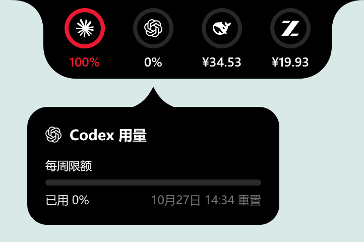

# 悬浮条与详情卡的外观和动效

Windows 版现在参照原版 Pulse 的展开、收起和详情卡弹出方式。原生悬浮条窗口保持固定大小，只有可见外形连续变形；读数更新复用已有圆环，避免悬停目标和坐标系反复变化。

## 对照参数

对照原版 1.12.2 的提交 `b035a7acf1aad9c1b6f9f895197ad1a5f58ea64e`，并核对 1.12.4 的相同行为。

| 动作 | 参数与行为 |
| --- | --- |
| 悬浮条展开、收起 | 弹簧 response 0.32、dampingFraction 0.86 |
| 详情卡进入、退出 | 弹簧 response 0.28、dampingFraction 0.84；缩放 0.88 到 1；从靠近悬浮条方向的 10 像素位移回到原位，同时淡入 |
| 圆环进入 | 延迟 0.12 秒，再以 ease-out 淡入 0.18 秒 |
| 圆环退出 | 以 ease-out 淡出 0.10 秒，无额外延迟 |
| 鼠标离开 | 详情卡等待 150 毫秒，悬浮条保留 320 毫秒收起延迟；进入详情卡时取消等待 |

response 表示弹簧响应参数，不是固定播放时长。Windows 实现按实际帧间隔解析求解阻尼弹簧，途中反向时保留当前位置和速度。动画运行时才订阅 WPF 渲染事件；完成、隐藏和关闭时停止，系统关闭界面动画时直接切到目标状态。

原版源码：[弹簧和卡片变换](https://github.com/qunqin24/Pulse/blob/b035a7acf1aad9c1b6f9f895197ad1a5f58ea64e/Sources/Pulse/Panel/FloatingUsagePanelContent.swift)、[固定窗口坐标系](https://github.com/qunqin24/Pulse/blob/b035a7acf1aad9c1b6f9f895197ad1a5f58ea64e/Sources/Pulse/Panel/FloatingPanelController.swift)、[栏内淡入淡出](https://github.com/qunqin24/Pulse/blob/b035a7acf1aad9c1b6f9f895197ad1a5f58ea64e/Sources/Pulse/Panel/UsageDockView.swift)。

## Windows 适配

- `RailChrome` 只重新绘制外形，不逐帧调整窗口或重新排版圆环。
- 详情卡仍使用独立的附属窗口，先在不可见状态完成布局和显示器定位，再播放内容变换。上下左右四个停靠方向分别使用靠近悬浮条的一边作为缩放中心。
- 快速移出再移入会反向继续当前动画；同账号刷新不重建卡片窗口，也不重播进入动画。
- 隐藏、全屏和窗口关闭会清理动画与详情卡；跨显示器或 DPI 改变时重新计算视口。

这些改动对齐交互与曲线。macOS 与 Windows 的字体、窗口合成不同，不能据此宣称逐帧完全一致。

## 验证

核心自动检查 235 项通过。原生 `Pulse.RailChecks` 完整检查通过，新增覆盖稳定圆环、四边停靠固定窗口、弹簧反向、延迟淡入无闪烁、详情卡重新进入、视口更新和隐藏/关闭清理。弹簧数学检查覆盖 24/60/144 帧分步一致性及长帧、反向和非法输入。

使用隔离数据目录和离线合成账号运行，没有借用个人登录或发送消息。`--render` 会捕获实际 `RailWindow` 和详情卡在 0、60、120、200、350、600 毫秒的过渡帧；这些图片用于检查形状、透明度和裁切，不能代替真实鼠标操作的主观流畅度验收。

```powershell
dotnet run --project tests/Pulse.Tests -c Release
dotnet run --project tests/Pulse.RailChecks -c Release -- artifacts/rail-motion-checks --render
```

## README 参考外观

上一版体验包对齐了弹簧参数，仍沿用 Windows 通用圆角面板。当前版本进一步对照原版 README 的顶部圆弧端头样式：纯黑贴边栏、32s 圆弧/外扩/肩部、250s 宽的紧凑卡片、20s 曲线指针和真实服务标记。



图片由隔离离线账号的真实 WPF 控件以 192 DPI 渲染后排版生成，金额和百分比仅是演示数据。原版 macOS 的连续圆角用 WPF 圆弧近似；曲线指针直接改编自原版几何，不将平台差异表述为逐像素复刻。

服务标记保留 Lobe Icons 的 MIT 许可及来源，随运行包分发。紧凑卡片显示限额、进度和重置时间，套餐、历史和本机信息继续由“显示详细卡片”控制；错误状态仍可见。卡片同尺寸刷新保留指针锚点，圆环视口留出外描边所需的透明空间。

补充检查覆盖四方向气泡指针、圆弧与柔化端头轮廓、同尺寸刷新锚点、外描边裁切和六语言 464 个资源键/占位符一致性。
